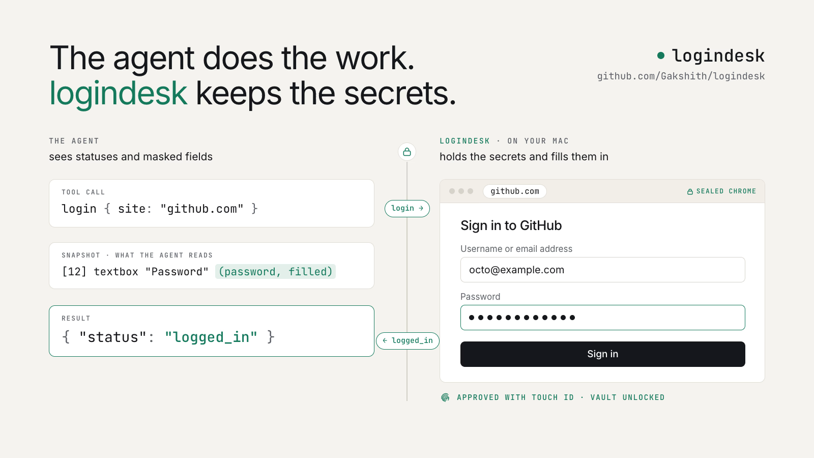

# logindesk

**Let an AI agent log in and sign up for you, without it ever seeing a password or a one-time code.**

<p align="center">
  
</p>
<p align="center"><a href="docs/media/logindesk-explainer.mp4">Watch the 30-second explainer (MP4)</a></p>

logindesk is a local MCP server for macOS. Your agent (Claude Code, Claude Desktop, Cursor, VS Code, Codex, Gemini CLI) asks it to log in. logindesk unlocks the account from its encrypted vault, types the password into its own sealed Chrome, reads the emailed code from your inbox, and hands back only a status.

```text
You:        "Log in to my GitHub and check the last deploy."
Agent  →    login { site: "github.com" }
logindesk:  vault → Touch ID (if the site asks) → its own Chrome → password typed → code read from Gmail
Agent  ←    { "status": "logged_in", "session_id": "4ccb…" }
Agent  →    snapshot / click / navigate …   (the page, with every field value masked)
```

The agent drives the work; logindesk holds the secrets. No tool returns a password, code, cookie or token, and none ever will.

> **Status: 0.1, working prototype (macOS).** Login, two-step logins, email-verified signup, agent-driven forms, Gmail/IMAP codes, Touch ID approvals and the audit log run end to end, on the included fake site and on real sites tested so far. Not externally audited: don't put accounts you can't afford to lose in it yet.

---

## How it works



```text
 ┌──────────┐  MCP (stdio)  ┌───────────────┐  Unix socket   ┌────────────────────────────┐
 │  Agent   │ ────────────▶ │ logindesk mcp │ ─────────────▶ │ logindesk daemon           │
 │ (Claude) │ ◀──────────── │ (no secrets)  │ ◀───────────── │ vault · grants · Touch ID  │
 └──────────┘   status only └───────────────┘   status only  │ audit · Gmail/IMAP codes   │
                                                             │   └─ sealed Chrome (pipe)  │
                                                             └────────────────────────────┘
```

- **Daemon:** unlocks the vault once (like `ssh-agent`) and is the only process that ever holds a secret.
- **Sealed browser:** its own Chrome profile per site, driven over a pipe. There's no debugging port, no extensions and no sync, and it shares nothing with your normal Chrome.
- **MCP server:** a thin client. It forwards intents and returns statuses.

## Requirements

- macOS (Apple silicon or Intel) with Touch ID or a Mac password
- Google Chrome
- Rust (the version in `rust-toolchain.toml`; `rustup` picks it up)

## Install

```bash
git clone https://github.com/Gakshith/logindesk && cd logindesk
cargo install --path crates/cli --locked      # puts `logindesk` in ~/.cargo/bin
```

## Set up (once)

```bash
logindesk setup                                            # create the encrypted vault (choose a vault password)
logindesk vault import --csv ~/Downloads/passwords.csv --delete-csv
                                                           # Google/Chrome, Firefox, Safari, Bitwarden, 1Password exports
logindesk identity set --email you@gmail.com --name "Your Name"   # who signups are made as
logindesk connect imap --preset gmail --user you@gmail.com        # read emailed codes (Gmail app password)
logindesk install --client claude-code                     # or claude-desktop, cursor, vscode, codex, gemini
logindesk doctor                                           # every check should pass
```

Then, each time you log in to your Mac, start the broker and leave it running:

```bash
logindesk daemon            # asks for the vault password once; add --headful to watch the browser
```

That's it. Ask your agent: *"Use logindesk to log in to github.com and tell me my open pull requests."*

### Claude Code plugin (optional)

The plugin adds a skill that teaches Claude when to use each tool. It still needs the binary and a running daemon.

```text
/plugin marketplace add Gakshith/logindesk
/plugin install logindesk@logindesk
```

## The tools your agent gets

| Tool | What it does |
|---|---|
| `login { site, account? }` | Logs in with a stored account: maps the form, fills the password, reads the emailed code. |
| `signup { site, url? }` | Creates an account with your identity's per-site email (`you+site@…`) and a generated password, saved to the vault and verified by email. |
| `wait { handle }` | Collects the result when a login or signup is waiting on your Touch ID. |
| `list_accounts { site? }` | Lists stored accounts: id, site and username only. |
| `snapshot { session_id }` | Shows the page as lines like `[12] textbox "Password" (password, empty)`, never a field value. |
| `navigate`, `click`, `close_session` | Move around the logged-in site, which is fenced to its own domain. |
| `open { url }` | Opens any page to fill step by step, for forms `login`/`signup` can't map. |
| `type { session_id, ref, text }` | Types non-secret text: name, phone, address, dropdown options. Refused on password and code fields. |
| `fill_secret { session_id, ref, secret }` | logindesk fills `password`, `new_password` (and its confirm box), `email` or `code` into that field. The agent never sees the value. |
| `press_enter { session_id, ref }` | Submits a field's form. |

## You stay in control

```bash
logindesk grant add github.com --tier auto                   # log in with no prompt
logindesk grant add example.com --tier auto --action signup  # allow signups there
logindesk grant add bank.com --tier deny                     # never
logindesk grant list
```

- Sites without a grant are `ask`: every login shows Touch ID, naming the agent that asked: *let the agent "claude-code" (unverified) log in on amazon.com*.
- Banking, government and health sites are blocked for signup.
- Signups are limited to 10 a day, and logindesk won't create a second account with the same email.
- The agent asks you before ticking any terms box, and asks you for details it doesn't know, like a phone number. It never asks for a password or a code.
- Every action goes into a hash-chained audit log: which agent, which site, what happened. It holds no values.
  The log is at `~/Library/Application Support/logindesk/audit.jsonl`.

## Try it without real accounts

```bash
scripts/try-it.sh
```

This runs a throwaway vault, a fake website with a fake inbox, and the daemon, then prints the exact commands and prompts to try (login, emailed code, signup, an unpredictable signup form). Nothing touches your real vault, sites or mailbox, and you don't need Docker.

## Security model

- **Secrets never reach the agent.** They aren't in tool results, socket frames, logs, errors or the audit log, and a leak harness checks that in CI.
- **Fenced filling.** A password goes only into a real `type=password` field, on a page and a form action whose registrable domain matches the account's site (`examp1e.com` is not `example.com`).
- **Safe code reading.** Emailed codes are read by a strict parser, never by a model, and must come from the site's own domain. A used code is never reused.
- **Encrypted vault.** It is encrypted at rest under an Argon2id key and unlocked only inside the daemon. The socket is reachable only by your user (`0700` folder, `0600` socket, per-start token).
- **Limits.** Known gaps and non-goals, such as malware already running as you, are listed in [`docs/threat-model.md`](docs/threat-model.md).

Read more: [`SECURITY.md`](SECURITY.md) · [`RESPONSIBLE_USE.md`](RESPONSIBLE_USE.md) · [`docs/threat-model.md`](docs/threat-model.md) · [`docs/crypto-spec.md`](docs/crypto-spec.md)

## Troubleshooting

| Symptom | Fix |
|---|---|
| `start logindesk daemon in a terminal` | The daemon isn't running. Run `logindesk daemon`. |
| `vault_locked` | The vault was locked (`logindesk lock`, or the daemon's `--lock-after <minutes>` idle timeout). Restart `logindesk daemon`. |
| `email_not_connected` | Run `logindesk connect imap --preset gmail --user you@gmail.com` (or `connect gmail`). |
| `field_mapping_failed` | Let the agent use `open` + `type` + `fill_secret`. The exact reason is in the audit log's `reason_detail`. |
| `needs_user` | A CAPTCHA, an SMS code or something unknown. Finish that step yourself; run the daemon with `--headful` to see the page. |
| Anything else | Run `logindesk doctor`. Each failed check prints its fix. |

## Development

```bash
cargo fmt --check
cargo clippy --workspace --all-targets -- -D warnings
cargo test --workspace            # includes real-Chrome tests against the fake site
cargo deny check && cargo audit
```

| Path | What's there |
|---|---|
| `crates/core` | `Secret<T>`, ids, statuses, limits |
| `crates/vault` | Encrypted SQLite vault (XChaCha20-Poly1305, Argon2id), CSV import |
| `crates/policy` | Site matching (Public Suffix List), grants, signup blocklist |
| `crates/approver` | Touch ID / Mac password approvals |
| `crates/executor` | Sealed Chrome over a CDP pipe: mapping, fills, masked snapshots |
| `crates/mail` | Gmail API, IMAP and test mail sources; OTP parser |
| `crates/daemon` | The broker: socket, gates, flows, audit |
| `crates/mcp` | The MCP stdio server |
| `crates/cli` | The `logindesk` binary |
| `testbed/` | Fake site, fake inbox, hostile-client and leak harnesses (test only) |
| `docs/` | Socket protocol, contracts, mail, threat model, crypto spec, research |

## Roadmap

- **0.2:** approvals from your phone, encrypted sync between devices, a signed and notarised build with Homebrew.
- **Later:** Linux and Windows, SMS codes, passkeys.

## Licence

Apache-2.0. See [LICENSE](LICENSE).
